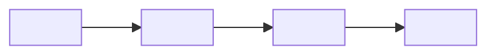
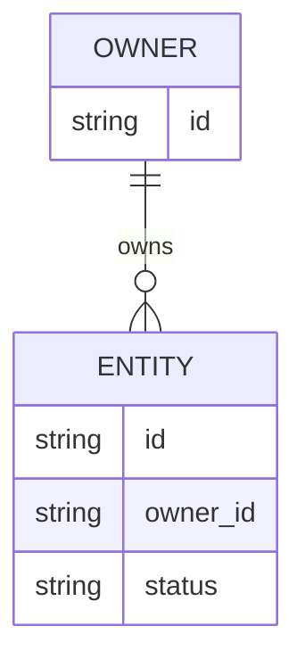
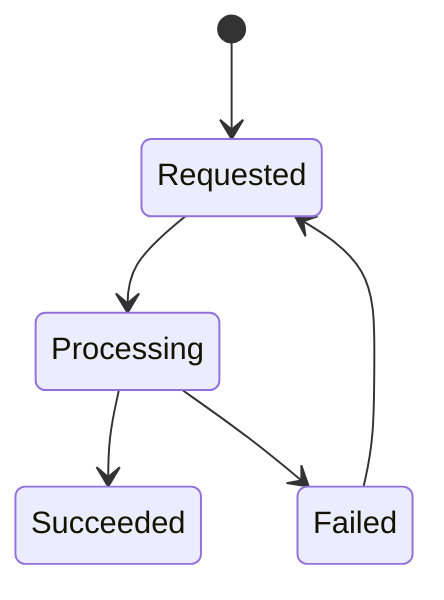

# Design: <change title>

## 1. Summary and Decision

<一句话说明目标状态、主决策及最重要的边界。>

## 2. Backend Impact Assessment

| Dimension | In scope? | Evidence / factual N/A boundary | Decision refs |
|---|---|---|---|
| API / events | Yes / No | <facts> | D<id> |
| Data / storage | Yes / No | <facts> | D<id> |
| Lifecycle / async | Yes / No | <facts> | D<id> |
| Identity / authorization / tenancy | Yes / No | <facts> | D<id> |
| Deployment / operations | Yes / No | <facts> | D<id> |

**Risk tier:** B0 / B1 / B2 / B3.
**Reason:** <why this is the highest applicable tier>.

## 3. Scope and Non-goals

### In scope

- <item>

### Non-goals

- <item>

## 4. Current State, Target State and Gaps

| Architecture dimension | AS-IS | TO-BE | Gap | Decision |
|---|---|---|---|---|
| Application / interfaces | <fact> | <fact> | <gap or N/A> | D<id> |
| Data / storage | <fact> | <fact> | <gap or N/A> | D<id> |
| Deployment / operations | <fact> | <fact> | <gap or N/A> | D<id> |



## 5. Decisions

### D1 — <decision title>

- **Decision:** <chosen approach>.
- **Evidence:** <facts and constraints>.
- **Consequences:** <positive and negative consequences>.
- **Alternatives rejected:** <alternative and why it was rejected>.

### D2 — <decision title>

<repeat only when needed>

## 6. API and Event Contract

> For B0 or when no API/event is affected, state the factual N/A boundary here.

| Change | Audience | AuthN/AuthZ | Method + path or topic | Input | Output | Success / primary failures | Idempotency, concurrency, async semantics | Task / validation |
|---|---|---|---|---|---|---|---|---|
| Added / Modified / Removed / Not implemented | <caller> | <rule> | `<method> <path>` | <shape> | <shape> | <codes/events> | <semantics> | <task and layer> |

### Compatibility

<versioning, deprecation, consumer migration, or factual N/A boundary>

## 7. Data Model and Ownership

> For B0/B1 or when no state changes, state why no state is stored. For B2/B3, complete all subsections.

### Data change overview

| Entity / object | Owner | Classification | Create / update / delete | Retention / audit | Isolation |
|---|---|---|---|---|---|
| `<entity>` | <service/team> | <sensitivity> | <rules> | <rules> | <tenant/user/resource boundary> |

### Conceptual schema or object contract

```sql
-- Pseudocode only. Replace with the migration mechanism used by this project.
CREATE TABLE <entity> (
  id <type> PRIMARY KEY,
  owner_id <type> NOT NULL,
  status <type> NOT NULL,
  created_at <type> NOT NULL,
  updated_at <type> NOT NULL,
  UNIQUE (owner_id, <business_key>)
);
```



### Consistency and failure handling

<transactions, idempotency key, uniqueness, ordering, concurrency control, partial failure, reconciliation, or factual N/A>

## 8. Lifecycle, Async and External Dependencies

> For synchronous, dependency-free behavior, state that boundary explicitly.



| Concern | Rule |
|---|---|
| Timeout | <value source and behavior> |
| Retry / backoff | <which failures, limits, owner> |
| Cancel | <who can cancel and resulting state> |
| Delete / expire | <trigger, authorization, retention, recovery> |
| Compensation | <action or factual N/A> |

## 9. Identity, Authorization and Audit

| Actor | Authentication | Authorization | Scope / isolation | Audit event |
|---|---|---|---|---|
| <actor> | <mechanism> | <policy> | <boundary> | <event fields, excluding secrets> |

<Explain trusted identity propagation and why client-controlled identifiers cannot widen access.>

## 10. Migration, Rollback and Operations

| Area | Forward plan | Rollback / recovery | Verification |
|---|---|---|---|
| Schema/data | <plan or N/A> | <plan or N/A> | <evidence> |
| Configuration | <plan or N/A> | <plan or N/A> | <evidence> |
| Deployment | <plan or N/A> | <plan or N/A> | <evidence> |
| Observability | <logs, metrics, traces, alerts> | <degraded-mode signal> | <evidence> |

## 11. Test Strategy

| Behavior / risk | RED test | GREEN implementation task | Lowest valid layer | Higher-layer evidence | Why not lower / higher |
|---|---|---|---|---|---|
| <behavior> | <test name and expected failure> | <task> | V0–V4 | <if needed> | <reason> |

<Reference `docs/testing-pyramid.md`. Every V4 assertion must explain why V2/V3 cannot prove it.>

## 12. Documentation and Contract Synchronization

| Artifact | Required change | Owner task |
|---|---|---|
| Capability spec | <delta/main spec> | <task> |
| API/event contract | <location or N/A reason> | <task> |
| Configuration/deployment | <location or N/A reason> | <task> |
| Runbook/operations | <location or N/A reason> | <task> |

## 13. Risks, Trade-offs and Open Questions

| Item | Impact | Mitigation / default behavior | Owner | Decision deadline |
|---|---|---|---|---|
| <risk or open question> | <impact> | <mitigation> | <role> | <milestone> |
