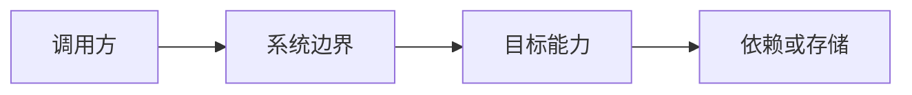
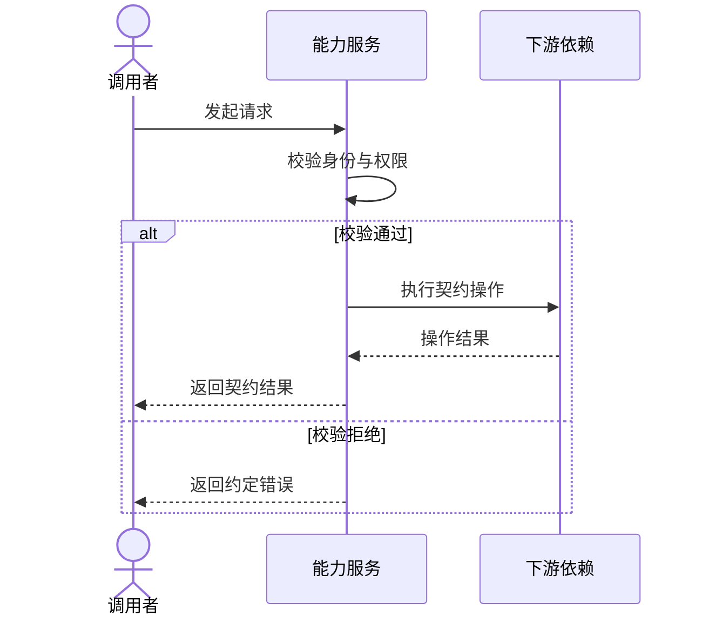
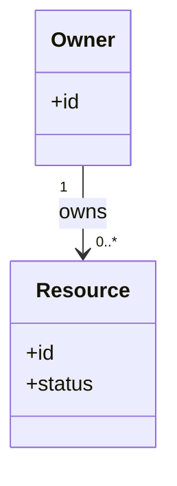
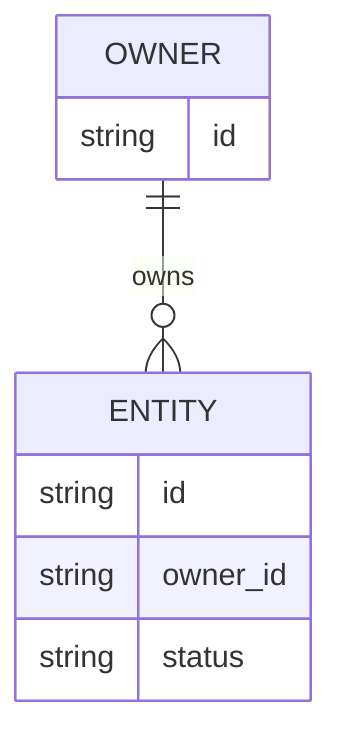
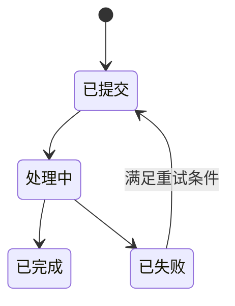

# 设计：<变更标题>

> Mermaid / UML 仅在有助于理解关系、交互或状态时生成。按模板使用说明选图，删除不适用示例；图不能替代正文契约，示例不代表设计决策。

## 1. 摘要与核心决策

<用一句话说明目标状态、核心决策及最重要的边界。>

## 2. 后端影响评估

| 维度 | 是否涉及 | 事实依据 / N/A 边界 | 决策引用 |
|---|---|---|---|
| API / 事件 | 是 / 否 | <事实依据> | D<编号> |
| 数据 / 存储 | 是 / 否 | <事实依据> | D<编号> |
| 生命周期 / 异步 | 是 / 否 | <事实依据> | D<编号> |
| 身份 / 授权 / 租户 | 是 / 否 | <事实依据> | D<编号> |
| 部署 / 运维 | 是 / 否 | <事实依据> | D<编号> |

**风险等级：** B0 / B1 / B2 / B3。
**判定依据：** <说明为何适用该最高风险等级>。

## 3. 范围与非目标

### 范围内

- <事项>

### 非目标

- <事项>

## 4. 现状、目标状态与差距

| 架构维度 | AS-IS（现状） | TO-BE（目标） | 差距 | 决策 |
|---|---|---|---|---|
| 应用 / 接口 | <事实> | <事实> | <差距或 N/A> | D<编号> |
| 数据 / 存储 | <事实> | <事实> | <差距或 N/A> | D<编号> |
| 部署 / 运维 | <事实> | <事实> | <差距或 N/A> | D<编号> |

> 按需：系统边界、依赖或现状到目标的变化难以用上表说明时生成结构图，并标明 AS-IS / TO-BE。



## 5. 设计决策

### D1 — <决策标题>

- **决策：** <选定方案>。
- **依据：** <事实与约束>。
- **影响：** <正面与负面影响>。
- **未选方案：** <备选方案及未采用原因>。

### D2 — <决策标题>

<仅在需要时重复本节>

## 6. API 与事件契约

> B0 或不影响 API / 事件时，在此说明事实性 N/A 边界。

| 变更类型 | 调用方 | 认证 / 授权 | 方法与路径或主题 | 输入 | 输出 | 成功 / 主要失败 | 幂等、并发与异步语义 | 任务 / 验证 |
|---|---|---|---|---|---|---|---|---|
| 新增 / 修改 / 移除 / 不实现 | <调用方> | <规则> | `<方法> <路径>` | <结构> | <结构> | <状态码 / 事件> | <语义> | <任务及验证层级> |

### 交互时序（可选）

> 仅当调用顺序、授权边界、异步或失败处理影响契约时生成 UML 时序图；简单同步调用删除本小节。替换示例参与者、消息和分支，按实际契约补充超时、重试或补偿路径。



### 兼容性

<版本管理、弃用、调用方迁移，或事实性 N/A 边界>

## 7. 数据模型与归属

> B0/B1 或不改变状态时，说明为何不存储状态。B2/B3 必须填写所有子章节。

### 数据变更概览

| 实体 / 对象 | 归属方 | 数据分类 | 创建 / 更新 / 删除 | 保留 / 审计 | 隔离边界 |
|---|---|---|---|---|---|
| `<实体>` | <服务 / 团队> | <敏感级别> | <规则> | <规则> | <租户 / 用户 / 资源边界> |

### 概念模型或对象契约

```sql
-- 仅为伪代码；替换为本项目实际使用的迁移方式。
CREATE TABLE <entity> (
  id <type> PRIMARY KEY,
  owner_id <type> NOT NULL,
  status <type> NOT NULL,
  created_at <type> NOT NULL,
  updated_at <type> NOT NULL,
  UNIQUE (owner_id, <business_key>)
);
```

### 领域关系（可选）

> 仅当多个领域对象的职责或关系需要解释时生成 UML 类图；只画关键概念、关系和多重性，不罗列实现类。若 ER 图已回答同一问题，删除本图。



> 按需：持久化实体的外键、归属或基数需要解释时保留以下 ER 图，替换为实际实体和约束。



### 一致性与故障处理

<事务、幂等键、唯一性、顺序、并发控制、部分失败、对账，或事实性 N/A>

## 8. 生命周期、异步处理与外部依赖

> 对于同步且无外部依赖的行为，明确说明该边界。

> 按需：多个业务状态及其转换规则影响行为时生成 UML 状态图；标注实际转换条件和适用的失败、取消、过期、重试及终态，不默认允许重试。简单无状态行为删除本图。



| 事项 | 规则 |
|---|---|
| 超时 | <取值依据及超时行为> |
| 重试 / 退避 | <适用失败、次数限制、负责人> |
| 取消 | <谁可取消及取消后的状态> |
| 删除 / 过期 | <触发条件、授权、保留期限、恢复方式> |
| 补偿 | <补偿操作或事实性 N/A> |

## 9. 身份、授权与审计

| 参与者 | 身份认证 | 授权 | 范围 / 隔离 | 审计事件 |
|---|---|---|---|---|
| <参与者> | <机制> | <策略> | <边界> | <事件字段，不含机密> |

<说明可信身份如何传递，以及为何客户端可控标识符不能扩大访问范围。>

## 10. 迁移、回滚与运维

| 领域 | 正向变更方案 | 回滚 / 恢复方案 | 验证 |
|---|---|---|---|
| Schema / 数据 | <方案或 N/A> | <方案或 N/A> | <证据> |
| 配置 | <方案或 N/A> | <方案或 N/A> | <证据> |
| 部署 | <方案或 N/A> | <方案或 N/A> | <证据> |
| 可观测性 | <日志、指标、追踪、告警> | <降级信号> | <证据> |

## 11. 测试策略

| 行为 / 风险 | RED 测试 | GREEN 实现任务 | 最低有效层级 | 高层验证证据 | 为何不选更低 / 更高层 | 准入理由及预计成本 |
|---|---|---|---|---|---|---|
| <行为> | <测试名称及预期失败> | <任务> | V0–V4 | <如需要> | <原因> | <现有覆盖、预计耗时、资源清理、负责人> |

<参考 `docs/testing-pyramid.md`。每个 V4 断言都必须说明为何 V2/V3 无法验证。>

### 测试增长与预算影响

| 新增或变更的测试 | 行为 / 风险 | 现有覆盖 | 为何此层是最低有效层级 | 预计常规成本 | 预算影响 / 缓解措施 | 负责人 |
|---|---|---|---|---|---|---|
| <测试或套件> | <风险> | <无或现有测试> | <事实依据> | <耗时 / 串行依赖> | <预算文件引用及措施> | <角色> |

- **预算依据：** `<项目维护的预算文件>`。
- **历史基线：** `<记录位置、统计窗口及回归策略>`。
- **超预算处置：** 去重 → 将断言下移 → 消除固定开销 → 隔离争用 → 修复依赖 → 最后才考虑经批准的预算变更。
- **禁止的权宜做法：** 重试、弱化断言、全局增加超时、未隔离的并行执行，以及用扩容替代测试重分配。

### e2e 选择与全量回归

| 变更路径类别 | V4 选择规则 | 证据 |
|---|---|---|
| `alwaysFull` | 全量 V4 | <覆盖映射规则> |
| 已映射的功能 | 登录 / 前置条件 + 映射的规格 | <覆盖映射规则> |
| `noE2e` | 不运行 V4；运行指定的低层测试 | <V1/V2/V3 及负责人> |
| 未知可执行路径 | 警告并运行全量 V4 | <安全默认行为> |

<合并请求可运行选中的 V4 子集；发布和定期回归以强制模式运行全量 V4。>

## 12. 文档与契约同步

| 工件 | 必须完成的变更 | 对应任务 |
|---|---|---|
| 能力规格 | <变更规格 / 主规格> | <任务> |
| API / 事件契约 | <位置或 N/A 原因> | <任务> |
| 配置 / 部署说明 | <位置或 N/A 原因> | <任务> |
| 运行手册 / 运维文档 | <位置或 N/A 原因> | <任务> |

## 13. 风险、权衡与待决问题

| 事项 | 影响 | 缓解措施 / 默认行为 | 负责人 | 决策截止时间 |
|---|---|---|---|---|
| <风险或待决问题> | <影响> | <缓解措施> | <角色> | <里程碑> |
