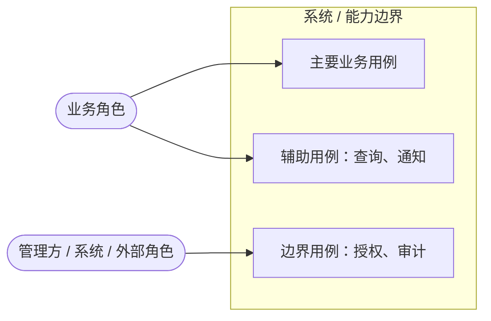
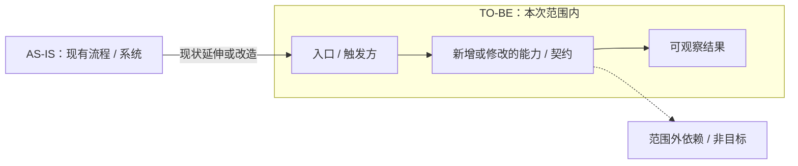

# 提案：<变更标题>

> Mermaid / UML 仅在有助于说明参与者、价值或范围边界时按需生成，删除不适用示例；提案阶段的图只描述问题、期望结果与范围，不代表已确认的实现方案，契约、数据与状态细节图放在 design。

## 问题

<谁在什么情境下遇到什么问题；现有行为、约束和证据是什么？>

## 期望结果

<交付后可观察到的结果；不要写实现方式。>

> 按需：参与者与用例（谁、获得什么可观察结果）难以用文字说清时生成。为兼容 Mermaid 11.x 及常见预览环境，此处用流程图表达角色与用例关系：角色在系统边界外，用例在边界内。只画业务角色与价值，不画界面、数据或实现；简单变更删除本图。

## 范围

- <范围内的能力或契约变更>
- <范围内的能力或契约变更>

> 按需：现状到目标的变化、范围边界或跨模块依赖难以用“范围 / 非目标”列表说清时生成结构图；标明 AS-IS / TO-BE 与范围内 / 范围外，范围外依赖用虚线。简单变更删除本图。

## 非目标

- <明确排除的工作>
- <明确排除的工作>

## 能力影响

| 能力 | 变更类型 | 原因 |
|---|---|---|
| `<能力>` | 新增 / 修改 / 移除 / 无变化 | <原因> |

## 影响摘要

| 领域 | 影响 | 验证方式 / 风险章节 |
|---|---|---|
| API / 事件 | <是否影响及事实依据> | <design 章节或 N/A 原因> |
| 数据 / 存储 | <是否影响及事实依据> | <design 章节或 N/A 原因> |
| 身份 / 授权 | <是否影响及事实依据> | <design 章节或 N/A 原因> |
| 部署 / 运维 | <是否影响及事实依据> | <design 章节或 N/A 原因> |

## 验收证据

- <可观察结果一>
- <可观察结果二>
- <所需验证层级及发布条件>

## 依赖与待决问题

- <依赖、负责人、截止时间、默认行为；或说明“无”及其原因>
